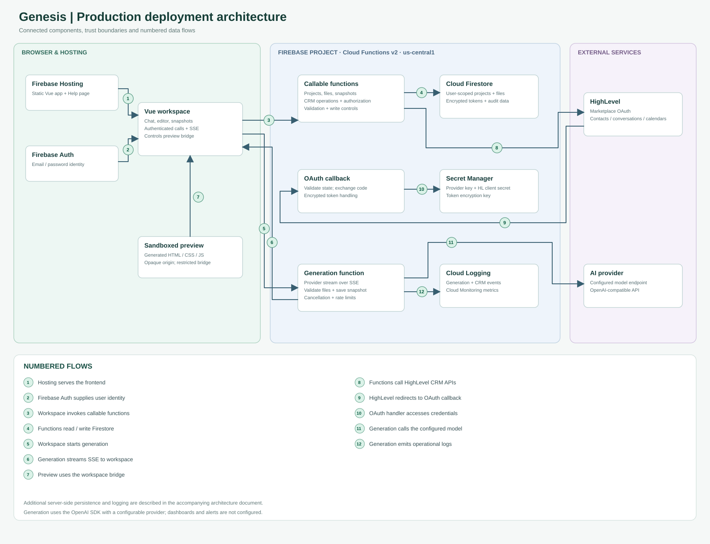

# Genesis production architecture

Genesis uses Firebase managed services to run a secure workspace for building and previewing HighLevel-connected applications. The diagram shows the deployment components, trust boundaries and data flows.

[Open the full-size architecture diagram](diagrams/genesis-production-architecture.svg)

## Scope and deployment

| Boundary | Components and responsibility |
| --- | --- |
| Browser | Vue workspace, Firebase client, editor, chat, history and isolated generated-app preview. The preview iframe uses `allow-scripts` and `allow-forms` and lacks same-origin permission. |
| Firebase Hosting | Serves the built frontend and static Help page. Hosting also defines API rewrites; generation can use the direct Functions URL for longer SSE streams. |
| Firebase project, us-central1 | Firebase Authentication, callable functions, OAuth callback, generation HTTP function, Firestore and Secret Manager. Functions v2 execute on managed infrastructure. |
| External services | HighLevel Marketplace and CRM APIs; the configured AI provider, accessed through the OpenAI SDK. |
| Operations | Cloud Logging records application events; Cloud Monitoring provides platform metrics. |

## Numbered flows

The arrows show the main interactions in the connected deployment view; the numbers identify interactions rather than a strict timeline. Some shared storage and logging paths are omitted to keep the view legible.

1. Firebase Hosting serves the Vue application and Help page to the browser.
2. Firebase Authentication authenticates the workspace user and provides an identity token.
3. The workspace calls backend functions for project and CRM operations. Functions validate input and ownership; supported CRM writes require user confirmation.
4. Backend functions access user-scoped Firestore records, including projects, files, snapshots and integration metadata.
5. The workspace sends an authenticated generation request to the HTTP function.
6. The generation function streams events back to the workspace over SSE.
7. The isolated preview uses the workspace bridge for supported CRM requests; it does not receive OAuth credentials.
8. CRM functions call HighLevel with the connected location's server-side credentials.
9. HighLevel redirects the browser to the OAuth callback with an authorization code and state; the callback validates state and exchanges the code server-side.
10. The OAuth handler accesses its configured secrets. Credentials are encrypted before storage in Firestore; refresh is coordinated server-side.
11. The generation function sends bounded project context and the user's prompt to the configured model provider.
12. Generation emits structured events to Cloud Logging. CRM adapters emit events as well; platform logs and metrics have separate fields and settings.

Generation also accesses its configured model secret and persists validated files and snapshots to Firestore. These shared dependencies are not separately drawn. Snapshot diffs require a recorded generation baseline, and incomplete output may preserve valid files. Cloud Monitoring provides infrastructure metrics alongside these events.

## Interfaces and security

| Interface | Protocol / access | Implementation |
| --- | --- | --- |
| Browser → Firebase Auth | Firebase client SDK | Firebase Authentication establishes user identity. |
| Browser → callable functions | HTTPS, Firebase callable protocol and authenticated identity | Server validates inputs and ownership; App Check is optional. |
| Browser → generation | HTTPS POST with authenticated identity; SSE response | Long-running streams use the configured direct function URL. Cancellation and incomplete-output paths require end-to-end verification. |
| Preview → workspace | `postMessage` bridge | The iframe has no direct CRM token or arbitrary network access. Allowed actions and write confirmation are enforced by the host. |
| Functions → Firestore / Secret Manager | Server SDK and service identity | Client Firestore access is denied; server functions use service identities and configured secrets. |
| Functions → HighLevel / model | HTTPS with server-side credentials | External API limits, scope grants, provider availability and data-sharing boundaries apply. |
| HighLevel → callback | HTTPS redirect with code and state | Callback URI must match app registration; the state is validated and consumed server-side. |

## Operational configuration

- The generation endpoint is configured with 1 GiB memory, a 540-second timeout, concurrency of 10 and a maximum of 20 instances. Standard callable functions specify a maximum of 30 instances; the OAuth callback specifies 20. These are per-function settings, not guaranteed capacity or a billing cap.
- The application uses authentication and location checks, encrypted tokens, sandbox restrictions, write confirmation and rate limits.
- Cloud Logging and platform metrics support operational monitoring.
- Generation uses the OpenAI SDK with a configurable provider and server-side API credentials.
- See the [developer handbook](developer-handbook.md) and [runbooks](runbooks.md) for setup and operations.
